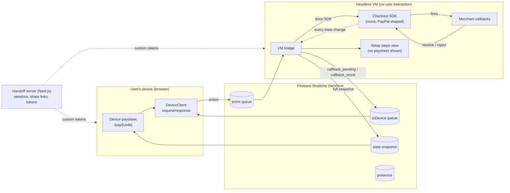

# Handoff architecture

Handoff lets a real person complete a checkout that is running somewhere they
can't reach: an agent's browser in a VM, on infrastructure the user has no
access to. The checkout SDK keeps running in the VM. The user gets a link,
sees the same paysheet on their own device, and every tap fires the SDK's real
merchant callbacks in the VM. Results stream back to the device.

## The problem

Checkout SDKs such as PayPal's run merchant callbacks inside the page that
rendered the paysheet:

- `onShippingAddressChange`: the merchant validates the address and returns
  shipping options and tax.
- `onShippingOptionsChange`: the merchant re-prices the order.
- `onApprove`: the merchant captures the order.

In an agentic flow, that page lives in a headless VM. The user can't click
anything there, but the callbacks still have to fire there, because that is
where the SDK and the merchant integration live. Mirroring pixels doesn't
solve this; the callbacks need a request/response path from the user's device
into the VM and back.

## The approach

Three rules hold the design together:

1. **The VM is the source of truth.** Only the VM writes paysheet state. The
   device renders snapshots and never applies optimistic updates.
2. **The device sends intents, not state.** It sends "set this shipping
   address" and the VM decides what that means, by running the SDK.
3. **Every request gets exactly one answer.** Each action carries an id, the VM
   answers with that id, and deadlines make sure nobody waits forever.

## Documents

| Document | What it covers |
|---|---|
| [Components](components.md) | Every moving part, where it runs, and which file implements it |
| [Protocol](protocol.md) | Messages, the callback round trip, snapshots, deadlines, failure cases |
| [Data model and security](data-model.md) | The RTDB tree, security rules, tokens, share links |
| [Session lifecycle](sessions.md) | Creating, joining, resuming, and taking over a session |
| [Deployment](deployment.md) | VPS, Docker, Traefik, Cloudflare DNS, Firebase, secrets, free tier |
| [Testing](testing.md) | The event-driven end-to-end suite and what it proves |

## Why Firebase Realtime Database

The transport had to be on GCP. The options considered:

| Option | Verdict |
|---|---|
| **Firebase Realtime Database** | Chosen. Push to browsers, `onDisconnect` presence, per-path security rules, free tier. |
| Firestore | Listener latency and per-write billing are a poor fit for chatty UI events. |
| GCP Pub/Sub | Server-to-server; no browser clients. |
| Cloud Run + WebSockets | Works, but needs Redis to bridge instances; more to run for the same result. |

All RTDB code lives in [`src/lib/channel.ts`](../src/lib/channel.ts). Everything
above it speaks the transport-agnostic protocol in
[`src/lib/protocol.ts`](../src/lib/protocol.ts), so moving to WebSockets later
means replacing one file.
