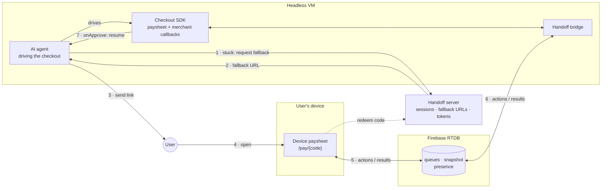

# Handoff architecture

An AI agent is checking out on a user's behalf, in a browser inside a VM. The
merchant's checkout SDK renders a paysheet there, and the agent fills in what
it can. Sometimes it can't finish: it doesn't know the shipping address, the
buyer has to pick a shipping option, or the buyer has to approve the payment
themselves.

Handoff is the agent's **fallback**. The agent asks for a **fallback URL** and
sends it to the user. The user opens it on their own device and sees the same
paysheet. Every tap fires the SDK's real merchant callbacks back in the VM,
results stream back to the device, and when the payment is approved the agent
picks up where it left off.

## The problem

Checkout SDKs such as PayPal's run merchant callbacks inside the page that
rendered the paysheet:

- `onShippingAddressChange`: the merchant validates the address and returns
  shipping options and tax.
- `onShippingOptionsChange`: the merchant re-prices the order.
- `onApprove`: the merchant captures the order.

In an agentic checkout, that page lives in a headless VM the user can't reach.
When the agent needs the user, the callbacks still have to fire in the VM,
because that is where the SDK, the merchant integration, and the agent's
session live. Restarting the checkout on the user's device would lose the
agent's work and the merchant's session; mirroring pixels would make the user
drive a remote browser. Instead, the user gets a native paysheet on their
device, and their actions travel to the VM as requests that the SDK answers.

## How it fits together

1. The agent hits a step it can't complete and asks the Handoff server for a
   fallback session.
2. The server returns a fallback URL (`/pay/{code}`), and the agent starts the
   Handoff bridge next to the SDK.
3. The agent sends the link to the user, wherever it already talks to them
   (chat, SMS, push).
4. The user opens it; the device exchanges the code for a session token.
5. The device sends the user's actions and renders the VM's snapshots.
6. The bridge turns each action into an SDK interaction, which fires the
   merchant callback, and sends the result and a fresh snapshot back.
7. When the SDK's `onApprove` resolves in the VM, the agent knows the checkout
   is done and carries on.

Three rules hold the design together:

1. **The VM is the source of truth.** Only the VM writes paysheet state. The
   device renders snapshots and never applies optimistic updates.
2. **The device sends intents, not state.** It sends "set this shipping
   address" and the VM decides what that means, by running the SDK.
3. **Every request gets exactly one answer.** Each action carries an id, the VM
   answers with that id, and deadlines make sure nobody waits forever.

## Documents

| Document | What it covers |
|---|---|
| [End-to-end flow](flow.md) | **Start here.** The full sequence from the agent's fallback to the agent resuming, plus the failure paths |
| [Components](components.md) | Every moving part, where it runs, and which file implements it |
| [Protocol](protocol.md) | Messages, the callback round trip, snapshots, deadlines, failure cases |
| [Data model and security](data-model.md) | The RTDB tree, security rules, tokens, fallback URLs |
| [Session lifecycle](sessions.md) | Creating, joining, resuming, and taking over a session |
| [Deployment](deployment.md) | VPS, Docker, Traefik, Cloudflare DNS, Firebase, secrets, free tier |
| [Testing](testing.md) | The event-driven end-to-end suite and what it proves |

## The demo vs. production

The live demo simulates the VM side in a browser tab so it can be shown
without an agent:

| In production | In the demo |
|---|---|
| The agent triggers the fallback when it gets stuck | **Launch VM paysheet** in the console |
| A real checkout SDK in the agent's browser | A mock SDK with PayPal-shaped callbacks |
| The merchant's own callback logic | `merchant.ts`, plus a "Hold responses" switch |
| The agent sends the fallback URL to the user | Copy the link, or "Open as device" |
| The agent resumes when `onApprove` resolves | The VM page's relay steps show the result |

## Why Firebase Realtime Database

The transport had to be on GCP. The options considered:

| Option | Verdict |
|---|---|
| **Firebase Realtime Database** | Chosen. Push to browsers, `onDisconnect` presence, per-path security rules, free tier. |
| Firestore | Listener latency and per-write billing are a poor fit for chatty UI events. |
| GCP Pub/Sub | Server-to-server; no browser clients. |
| Cloud Run + WebSockets | Works, but needs Redis to bridge instances; more to run for the same result. |

All RTDB code lives in [`src/lib/channel.ts`](../src/lib/channel.ts). Everything
above it speaks the transport-agnostic protocol in
[`src/lib/protocol.ts`](../src/lib/protocol.ts), so moving to WebSockets later
means replacing one file.
