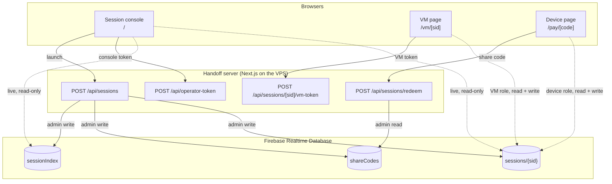

# Components

Dashed arrows are direct client connections to RTDB, authorized by custom
tokens and enforced by the [security rules](data-model.md). The Next.js server
never relays messages; it only creates sessions and mints tokens.

## In the browser

### Session console: `/`
[`src/app/page.tsx`](../src/app/page.tsx),
[`src/lib/console-feed.ts`](../src/lib/console-feed.ts)

Launches VM paysheets and lists every session live: status, whether the VM and
the device are connected, the order total, and any callback in flight. It
subscribes to `sessionIndex` plus three paths per session (`meta`, `presence`,
`state/paysheet`) with a read-only operator token. There is no polling.

### VM page: `/vm/[sid]`
[`src/app/vm/[sid]/page.tsx`](../src/app/vm/%5Bsid%5D/page.tsx)

Stands in for the headless VM. It doesn't show the paysheet at all (nobody
looks at it in a real VM) and nothing on it is clickable. It shows the relay:

- **Relay steps** ([`VmActivity.tsx`](../src/components/VmActivity.tsx)): one
  card per device request, built from the bridge's `VmEvent`s. Each step is
  labeled with its direction:

  | Step | Direction |
  |---|---|
  | `action set_shipping_address` (with a payload summary) | Device → VM |
  | `callback_pending onShippingAddressChange` | VM → Device |
  | SDK fired merchant callback `onShippingAddressChange` | In the VM |
  | Merchant resolved / rejected (with what changed, or the reason) | In the VM |
  | `callback_result resolved` plus the updated snapshot | VM → Device |

  Each step shows how long after the action arrived it happened.
- **Merchant simulator**: a "Hold responses" switch that stands in for the
  merchant's backend, so a demo can show a callback in flight.

### Device page: `/pay/[code]`
[`src/app/pay/[code]/page.tsx`](../src/app/pay/%5Bcode%5D/page.tsx),
[`src/components/PaySheetView.tsx`](../src/components/PaySheetView.tsx)

The interactive paysheet the user sees, laid out like a familiar wallet
checkout: a cart-total pill that expands into the order summary, "Ship to" with
a Change option, a shipping method list, a "Pay with" row, one full-width Pay
button, and "Cancel and return to merchant". It deliberately uses its own
"PaySheet" demo brand, not a real wallet's name or logo, since it runs on a
public URL.

It renders the VM's latest snapshot, and every interaction becomes a request
through `DeviceClient`. While a callback runs, an overlay names it ("Checking
your address with the merchant…"). Merchant rejections appear next to the
section they concern, in shopper language (`COUNTRY_ERROR` becomes "Bean There
Coffee doesn't ship to this country"). It is disabled while a request is in
flight or the VM is offline.

## Shared libraries

| File | Runs in | Responsibility |
|---|---|---|
| [`protocol.ts`](../src/lib/protocol.ts) | both | Wire types: actions, results, snapshots, session meta. No Firebase. |
| [`channel.ts`](../src/lib/channel.ts) | both | The only RTDB code: queues, presence, snapshots, the VM lease. |
| [`mock-paysheet-sdk.ts`](../src/lib/mock-paysheet-sdk.ts) | VM | Stand-in for a checkout SDK. Owns paysheet state, runs callbacks with a deadline, supports resuming from a snapshot. |
| [`merchant.ts`](../src/lib/merchant.ts) | VM | The merchant's callback logic: US-only shipping, AK/HI express only, state tax, rejects ZIP `00000`. |
| [`response-gate.ts`](../src/lib/response-gate.ts) | VM | Holds merchant responses until released (the "Hold responses" switch). |
| [`vm-bridge.ts`](../src/lib/vm-bridge.ts) | VM | Device action → SDK call → callback result back to the device. Publishes snapshots and emits `VmEvent`s. |
| [`vm-session.ts`](../src/lib/vm-session.ts) | VM | Boots or resumes one session: rehydrate the SDK, take the lease, start the bridge. |
| [`device-client.ts`](../src/lib/device-client.ts) | device | Request/response over the channel: correlation ids, the relay deadline. |
| [`firebase-client.ts`](../src/lib/firebase-client.ts) | both | One named Firebase app per role with in-memory auth, so a VM tab and a device tab in the same browser don't share a login. |

## On the server

| File | Responsibility |
|---|---|
| [`api/sessions/route.ts`](../src/app/api/sessions/route.ts) | Create a session: pick a cart, write the initial snapshot, mint a share code. |
| [`api/sessions/[sid]/vm-token/route.ts`](../src/app/api/sessions/%5Bsid%5D/vm-token/route.ts) | VM-role token for a new or resumed session. |
| [`api/sessions/redeem/route.ts`](../src/app/api/sessions/redeem/route.ts) | Exchange a share code for a device-role token. |
| [`api/operator-token/route.ts`](../src/app/api/operator-token/route.ts) | Read-only console token. |
| [`firebase-admin.ts`](../src/lib/firebase-admin.ts) | Admin SDK, initialized on first use and signing tokens locally with the service-account key. |

## What "the VM" means here

In production, the VM side is whatever runs the real checkout page: a
Playwright-driven browser, for example. The pieces that would move there are
`vm-session.ts`, `vm-bridge.ts`, and `channel.ts`. The mock SDK would be
replaced by an adapter that turns device actions into interactions with the
real paysheet (filling the address form, picking an option, clicking Pay) and
reports when the SDK's callbacks resolve. The protocol and the device side
don't change.
