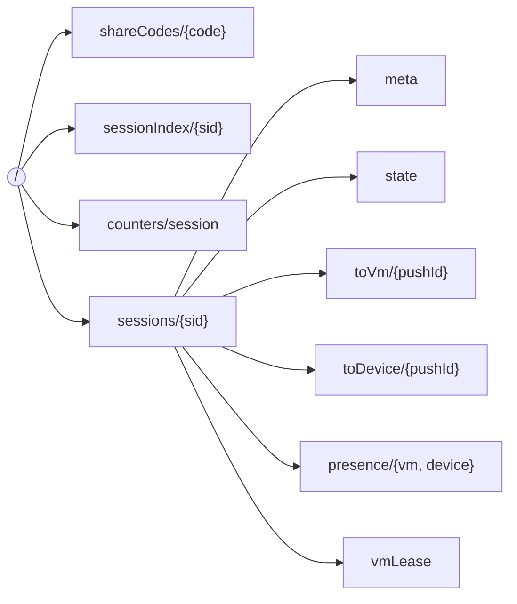
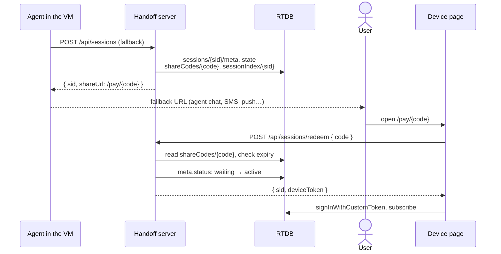

# Data model and security

## The RTDB tree

| Path | Shape | Written by | Read by |
|---|---|---|---|
| `shareCodes/{code}` | `{ sid, expiresAt }` | server | server |
| `sessionIndex/{sid}` | `{ code, label, createdAt, expiresAt }` | server | server, console |
| `counters/session` | number (for labels like `#1042`) | server | server |
| `sessions/{sid}/meta` | `{ status, label, createdAt, expiresAt }` | server creates; VM updates `status` | session, console |
| `sessions/{sid}/state` | `{ seq, paysheet }` | server (initial), VM | session, console |
| `sessions/{sid}/toVm/*` | action messages | device appends, VM deletes | session |
| `sessions/{sid}/toDevice/*` | callback messages | VM appends, device deletes | session |
| `sessions/{sid}/presence/{role}` | `true` while connected | each role, its own flag | session, console |
| `sessions/{sid}/vmLease` | tab id of the VM that owns the SDK | VM | session |

"Session" means a VM or device token for that `sid`.

## Tokens

The server mints [custom tokens](https://firebase.google.com/docs/auth/admin/create-custom-tokens)
with the Admin SDK. Clients exchange them with `signInWithCustomToken`, and the
claims become `auth.token` in the security rules.

| Token | uid | Claims | Minted by | For |
|---|---|---|---|---|
| VM | `vm:{sid}` | `{ sid, role: "vm" }` | `POST /api/sessions/{sid}/vm-token` | the VM page |
| Device | `device:{sid}` | `{ sid, role: "device" }` | `POST /api/sessions/redeem` | the device page (opened from the fallback URL) |
| Operator | `operator` | `{ role: "operator" }` | `POST /api/operator-token` | the console |

Each Firebase client app uses in-memory auth persistence, so a VM tab and a
device tab in the same browser keep separate identities.

## Security rules

[`database.rules.json`](../database.rules.json), summarized:

| Path | VM (own session) | Device (own session) | Operator | Anyone else |
|---|---|---|---|---|
| `shareCodes` | – | – | – | – |
| `sessionIndex` | – | – | read | – |
| `sessions/{sid}` (whole session) | read | read | read | – |
| `…/meta` | update | – | – | – |
| `…/state` | write | – | – | – |
| `…/toVm/{id}` | delete | append | – | – |
| `…/toDevice/{id}` | append | delete | – | – |
| `…/presence/{role}` | own flag | own flag | – | – |
| `…/vmLease` | write | – | – | – |

On top of that:

- A session token can only read its session until `meta/expiresAt`.
- Queue messages are validated: an action must have `type` and a string `id`;
  a VM message must have `type`.
- Appending means "create only": a device can't overwrite or edit a message
  already in `toVm`, only add new ones.
- Nobody can list `/sessions`, so a token for one session can't discover others.

The end-to-end suite checks these rules against the live database (see
[Testing](testing.md)).

## Fallback URLs

The fallback URL the agent sends the user is the device link, `/pay/{code}`.

- The code is 12 random bytes (base64url): unguessable and opaque. It reveals
  nothing about the session.
- The Firebase token never appears in a URL. The link carries the code; the
  token comes back in a POST response.
- A code can be redeemed again until it expires, so reloading the page
  reconnects. Sessions last 2 hours by default (`SESSION_TTL_SECONDS`).

## Known gaps (demo scope)

These are acceptable for a public demo and listed so they aren't mistaken for
design decisions:

- `POST /api/sessions` and `POST /api/operator-token` are unauthenticated.
  In production, session creation is service-to-service (the VM orchestrator)
  and the console sits behind staff login.
- Anyone with a device link can act on that session until it expires. In
  production, bind the link to the first device that redeems it.
- Expired sessions stay in the database until `npm run cleanup:live` runs.
  Scheduled cleanup would need Cloud Functions, which needs the paid plan.
