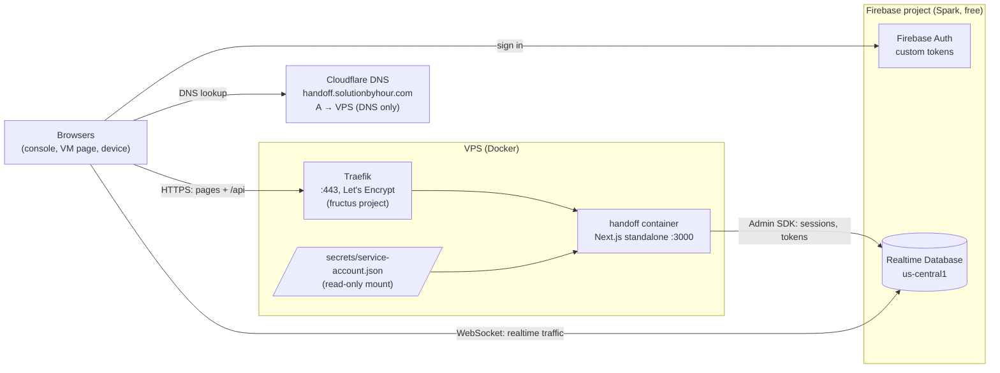

# Deployment

Live at **https://handoff.solutionbyhour.com**.



The VPS serves pages and the four API routes. **Realtime traffic never touches
the VPS**: browsers connect straight to Firebase over WebSockets, so the server
handles a few small requests per session no matter how chatty the checkout is.

## Files

| File | Purpose |
|---|---|
| [`deploy/Dockerfile`](../deploy/Dockerfile) | Two-stage build of the Next.js standalone server. `NEXT_PUBLIC_*` values come in as build args because Next inlines them into the client bundle. |
| [`deploy/docker-compose.yml`](../deploy/docker-compose.yml) | The container: read-only filesystem, all capabilities dropped, 1 CPU / 512 MB. Bound to `127.0.0.1:7090` only. |
| [`deploy/docker-compose.public.yml`](../deploy/docker-compose.public.yml) | Adds the Traefik route for `${HANDOFF_HOST}` with a Let's Encrypt certificate. |
| [`deploy/.env.example`](../deploy/.env.example) | The server-side `.env`, with placeholders. |
| [`deploy/deploy.sh`](../deploy/deploy.sh) | Typecheck, rsync the source, build and start on the VPS. No registry. |

## Deploying

```bash
./deploy/deploy.sh            # DEPLOY_HOST=ssdnode DEPLOY_DIR=handoff by default
```

On the VPS, `~/handoff` holds:

```
~/handoff/
├── .env                          # from deploy/.env.example (chmod 600)
├── secrets/service-account.json  # Firebase Admin key (chmod 600, dir 700)
├── Dockerfile, docker-compose*.yml
└── src/                          # rsynced source; the image is built from it
```

## Secrets

| Secret | Where it lives | Never in |
|---|---|---|
| Service-account key | your machine, outside the repo; `~/handoff/secrets/` on the VPS, mounted read-only | git, the Docker image |
| Server `.env` | `~/handoff/.env` on the VPS | git |
| Local live config | `.env.live` (gitignored); `.env.live.example` has placeholders | git |

The Firebase web API key and project ID end up in the client bundle; that is
how Firebase web apps work. They identify the project, they don't grant
access. Access is controlled by the [security rules](data-model.md) and by
the tokens only the server can mint.

## DNS and TLS

- Cloudflare holds an `A` record for `handoff` pointing at the VPS, **DNS only**
  (grey cloud), the same as the other solutionbyhour subdomains. Traefik gets
  the certificate from Let's Encrypt directly.
- Turning on the Cloudflare proxy later is possible but needs WebSocket support
  in mind. Here only page and API traffic would go through it; the Firebase
  WebSockets go to Google directly either way.

## Staying on the free plan

| Resource | Spark limit | Handoff's use |
|---|---|---|
| RTDB simultaneous connections | 100 | 2 per live session, 1 per open console |
| RTDB storage | 1 GB | a few KB per session |
| RTDB downloads | 10 GB / month | a few KB per transaction |
| Firebase Auth custom tokens | free | 1 sign-in per page load |
| Cloud Functions | not on Spark | not used (cleanup runs by hand) |

On Spark, going over a limit makes RTDB refuse connections; it can't create a
bill. Keep the project without a billing account to keep it that way.
