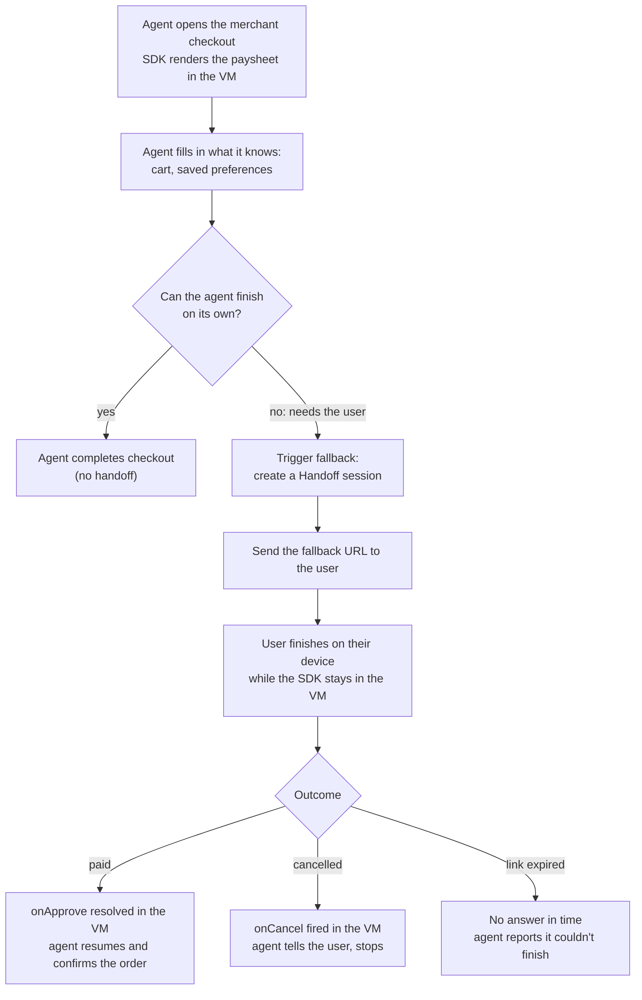
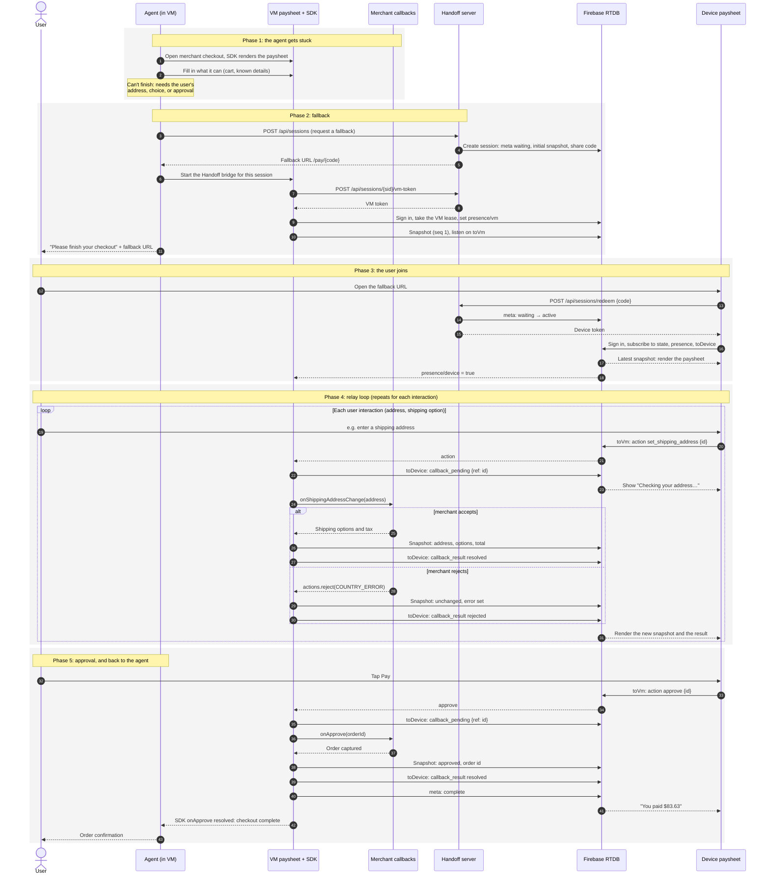
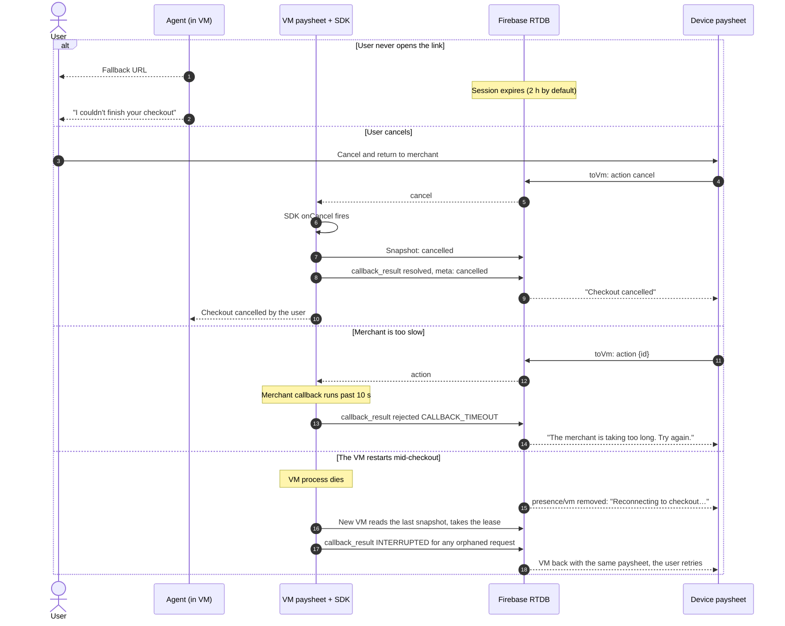

# End-to-end flow

The whole journey, from the agent getting stuck to the agent finishing the
checkout. Everything starts in the VM.

## When the agent falls back

Typical reasons to fall back:

- The agent doesn't know where to ship, or the address it has is rejected.
- The buyer has to choose between shipping options or prices.
- The buyer has to approve the payment themselves (consent, step-up, policy).

## The full sequence

What to notice:

- **The agent never leaves the VM, and neither does the SDK.** The user's
  device only sends intents and renders snapshots. The merchant sees one
  continuous checkout session.
- **The agent learns the outcome locally.** `onApprove` resolves inside the VM,
  in the same SDK instance the agent was driving, so no extra signal is needed
  to resume. `meta/status` also turns `complete` for anything watching from
  outside (the console, an orchestrator).
- **The fallback URL carries no secrets.** It holds an opaque code; the device
  exchanges it for a short-lived, session-scoped token over HTTPS.
- **Firebase carries the realtime traffic.** The Handoff server only creates
  the session and mints tokens. It never relays messages.

## Failure paths

Each of these is covered by the [end-to-end tests](testing.md), except the
expiry path, which only needs the clock to pass `expiresAt`.
