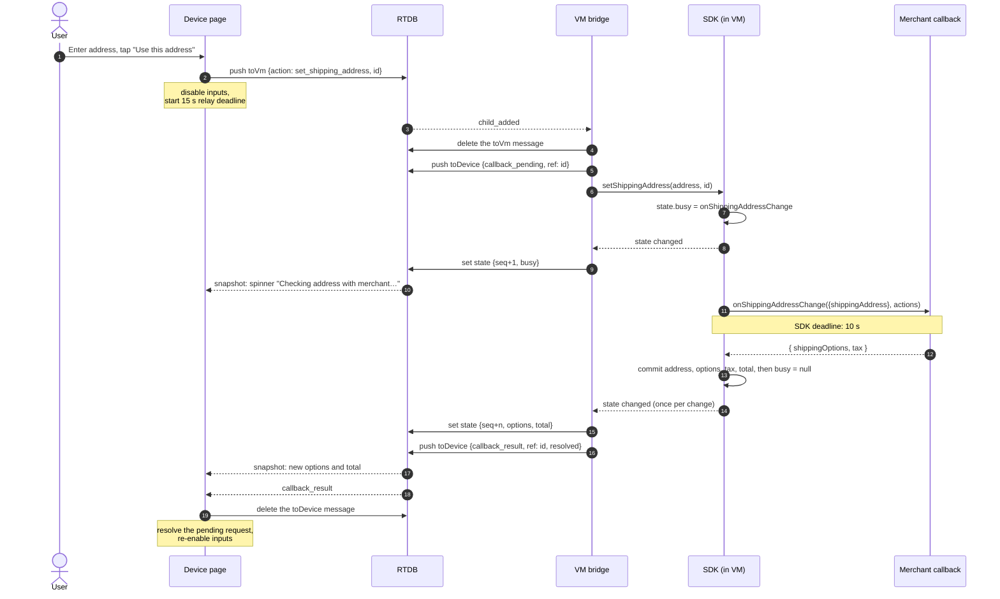
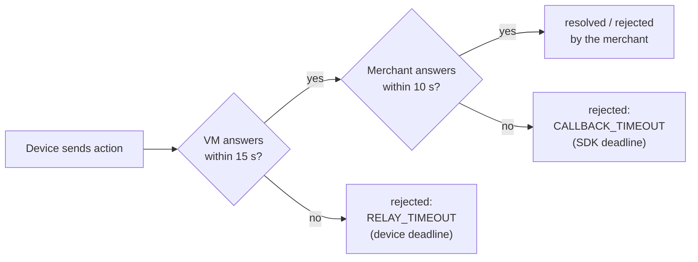

# Protocol

Defined in [`src/lib/protocol.ts`](../src/lib/protocol.ts). Nothing in it knows
about Firebase.

## Three channels per session

| Channel | Direction | Writer | Contents |
|---|---|---|---|
| `toVm` | device → VM | device appends, VM deletes after reading | Actions |
| `toDevice` | VM → device | VM appends, device deletes after reading | `callback_pending`, `callback_result` |
| `state` | VM → device | VM overwrites | The full paysheet, with a sequence number |

The queues carry the conversation; `state` carries the picture. The device
never reconstructs state from messages. It renders whatever the latest
snapshot says.

## Messages

### Device → VM: actions

```jsonc
{ "type": "action", "id": "dev-3f9c1a2b", "ts": 1792973857511,
  "action": "set_shipping_address",
  "payload": { "line1": "500 Congress Ave", "city": "Austin", "state": "TX",
               "postalCode": "78701", "countryCode": "US" } }
```

| `action` | `payload` | SDK call | Merchant callback |
|---|---|---|---|
| `set_shipping_address` | `Address` | `setShippingAddress` | `onShippingAddressChange` |
| `select_shipping_option` | `{ optionId }` | `selectShippingOption` | `onShippingOptionsChange` |
| `approve` | `null` | `approve` | `onApprove` |
| `cancel` | `null` | `cancel` | (SDK's `onCancel`) |

### VM → device: callback progress

```jsonc
{ "type": "callback_pending", "ref": "dev-3f9c1a2b",
  "callback": "onShippingAddressChange", "ts": 1792973857530 }

{ "type": "callback_result", "ref": "dev-3f9c1a2b",
  "callback": "onShippingAddressChange",
  "status": "rejected", "reason": "COUNTRY_ERROR", "ts": 1792973857610 }
```

`ref` is always the id of the action being answered.

### VM → device: state snapshot

```jsonc
{ "seq": 7,
  "paysheet": {
    "status": "open", "merchant": "Keebs & Co.", "currency": "USD",
    "items": [ ... ], "shippingAddress": { ... },
    "shippingOptions": [ { "id": "express", "label": "Express (2 days)",
                           "amount": 14.99, "selected": true } ],
    "tax": 15.08, "total": 237.99,
    "busy": null, "error": null, "orderId": null } }
```

`busy` is set while a callback runs, so the device shows the spinner even if it
reconnects mid-callback. RTDB drops `null`s and empty arrays when storing, so
readers pass snapshots through `normalizePaySheet()`.

## The callback round trip

What happens when the user changes the shipping address on their phone:



If the merchant rejects (step 13 becomes `actions.reject("COUNTRY_ERROR")`),
the SDK commits nothing, sets `error`, and the device gets
`status: "rejected", reason: "COUNTRY_ERROR"`. The address on the paysheet
stays what it was.

## Guarantees

**Ordering.** Push keys sort chronologically, and each queue has a single
writer, so messages arrive in the order they were sent. The SDK also refuses a
second callback while one is in flight (`BUSY`).

**Exactly one answer per request.** The VM keeps the ids it has seen and
ignores repeats. The device keeps a map of pending ids and ignores results it
isn't waiting for, such as a late reply after its deadline.

**No replays on reconnect.** Consumers delete messages as they read them, so a
reconnecting client never re-processes old messages. Snapshots carry `seq`;
the device ignores anything older than what it has already rendered.

**No optimistic UI.** The device's address form is local until submitted. What
the paysheet shows always comes from a VM snapshot.

## Deadlines

These are the only two timers in the codebase. Neither delays a request that
succeeds.



The device's deadline is longer than the SDK's on purpose: if the VM is alive,
the SDK's verdict always arrives first. `RELAY_TIMEOUT` only happens when the
VM itself is gone.

## Failure cases

| Situation | What the device sees |
|---|---|
| Merchant rejects | `rejected` with the merchant's reason, e.g. `COUNTRY_ERROR`, `ZIP_ERROR` |
| Merchant is too slow | `rejected: CALLBACK_TIMEOUT` after 10 s |
| VM tab dies, nobody reopens it | VM presence goes offline ("Checkout is reconnecting…"): at once if the tab closes, within about a minute if its network just drops. A pending request ends in `RELAY_TIMEOUT` after 15 s |
| VM dies mid-callback, then is reopened | The new VM rejects the orphaned request at startup: `INTERRUPTED` |
| A second VM tab takes over mid-callback | The new owner rejects the in-flight request: `INTERRUPTED`; the old tab's late result is dropped |
| Device reloads | Redeems the link again and renders the latest snapshot |
| Action not allowed now | `PAYSHEET_CLOSED`, `BUSY`, `ADDRESS_REQUIRED`, `SHIPPING_OPTION_REQUIRED` |
