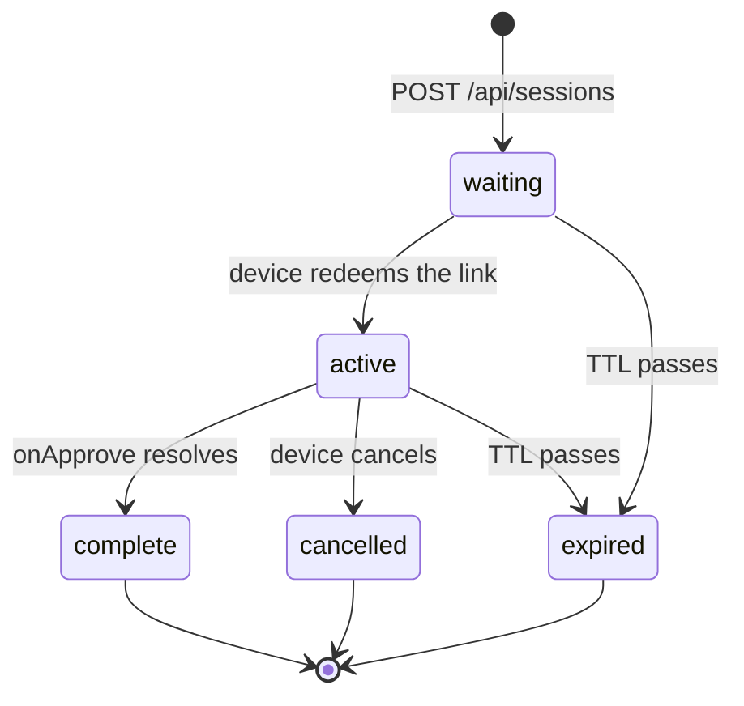
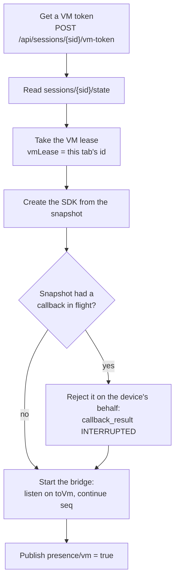
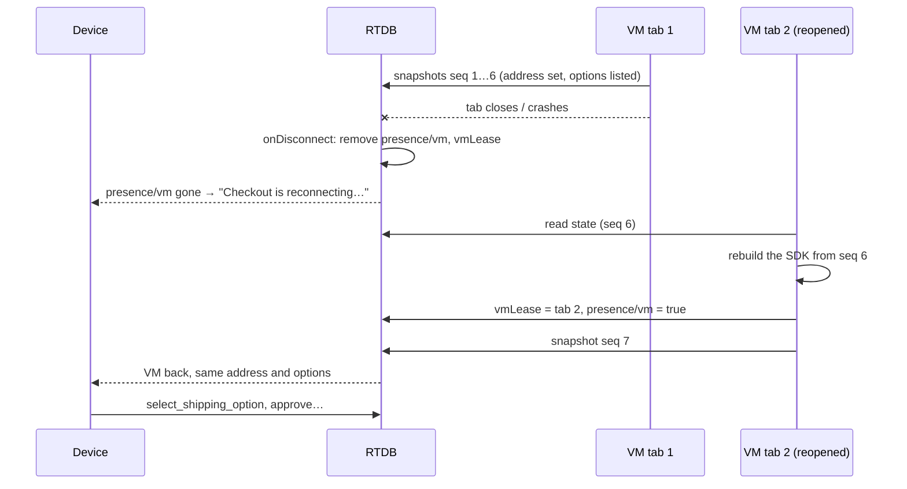
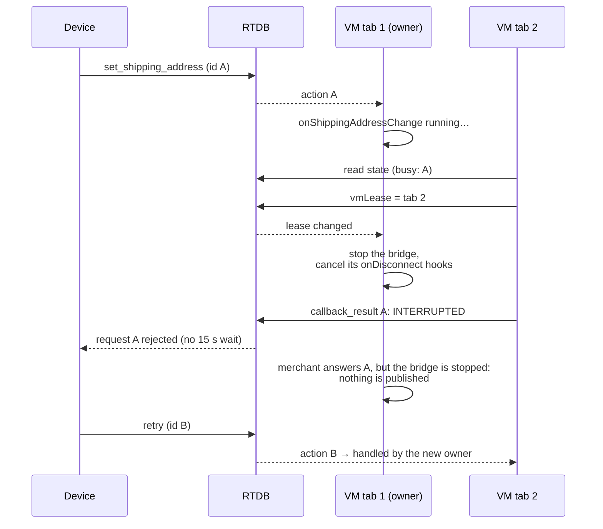

# Session lifecycle

## Status

`expired` isn't stored. Readers compute it from `expiresAt`, and the security
rules stop session tokens from reading the session past that point.

## Creating a session

The agent calls `POST /api/sessions` when it falls back (in the demo, the
console's **Launch VM paysheet** does it). One multi-path update writes
everything a session needs:

1. Picks a cart (one of five demo merchants) and a label such as
   `#1042 · Bean There Coffee`.
2. Writes `meta` (`waiting`), and the SDK's **initial state** as snapshot
   `seq: 0`.
3. Creates the share code behind the fallback URL, and the index entry.

Because the initial state is stored up front, opening a brand-new session and
resuming an old one are the same code path: the VM always starts by reading
`state`.

## Starting the VM

[`startVmSession()`](../src/lib/vm-session.ts):

## Presence

Each side writes `presence/{role} = true` whenever its connection comes up
(watching `.info/connected`) and registers an `onDisconnect` that removes the
flag. The Firebase server runs that removal itself when the connection drops,
with no heartbeats in the app: at once when a tab closes, and within about a
minute when a connection silently dies (a laptop lid closing, Wi-Fi dropping).

The device page disables itself and shows "Checkout is reconnecting…" while
`presence/vm` is missing.

## Resuming after the VM dies

The SDK's state survives because it lives in RTDB, not only in the tab. In a
real deployment the VM process would come back the same way after a restart.

## Two VM tabs: the lease

If the same session is opened in two VM tabs, both would consume `toVm` and
both would drive their own copy of the SDK. The lease prevents that: **the
newest tab wins**, and the old one stands down.

Two details matter:

- **The old tab cancels its `onDisconnect` hooks** when it loses the lease.
  Otherwise, closing it later would delete the new owner's lease and presence.
- **A stopped bridge stays quiet.** If the old tab's merchant callback finishes
  after the takeover, its result is not sent. The device already has
  `INTERRUPTED` and has moved on.

## Many sessions at once

Sessions share nothing except the index. Each has its own paths, tokens, rules
scope, VM, and device. The end-to-end suite runs eight complete transactions
in parallel and checks that each device ends on its own merchant's order.

On the free plan, the practical ceiling is RTDB's 100 simultaneous connections:
about 50 live sessions (one VM and one device each), less a few for open
consoles.
